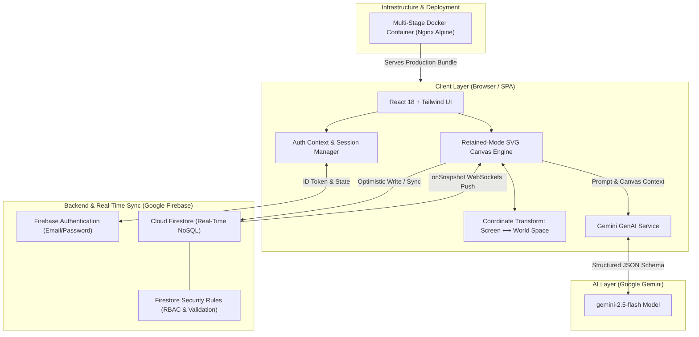

<div align="center">


# CollabCanvas 🎨

**A real-time collaborative vector whiteboard powered by React, Firebase, and Gemini AI.**

[](https://github.com/Raji-codes/CollabCanvas/actions/workflows/deploy.yml)

</div>

---

## 🚀 Features

- **Real-Time Multiplayer Collaboration:** Draw simultaneously with other users using Cloud Firestore snapshot listeners with sub-millisecond perceived latency and optimistic UI updates.
- **Live User Presence & Cursors:** View live remote user cursors and active usernames across the canvas in real-time.
- **Retained-Mode Vector Engine:** Native SVG-based vector rendering allowing clean geometric transformation, lossless zoom/pan, single-shape selection, boundary hit-testing, and SVG export.
- **Rich Vector Toolkit:** Pencil, Highlighter, Brush, Spray Can, Vector Eraser, Lines, Rectangles, Circles, and Text elements with customizable stroke/fill styling, stroke widths, and z-index ordering.
- **Generative AI Magic Wand (Google Gemini 2.5 Flash):** Natural language prompts generate structured vector graphics directly onto the canvas.
- **AI Scene Comprehension:** Serializes active whiteboard graphs into JSON payloads for real-time scene critique and visual drawing explanations.
- **Room Management & Authentication:** Create password-protected collaborative rooms with Firebase Authentication, or join as a guest with an 8-character invite code.
- **Infinite Canvas:** 2D Cartesian World-to-Screen coordinate projection supporting smooth panning and zoom from 10% to 500%.
- **Free Automated CI/CD:** GitHub Actions pipeline running linting, build checks, and automated deployment.

---

## 📐 System Architecture

CollabCanvas is built on a serverless, reactive event-driven architecture designed for ultra-low latency real-time collaboration, generative vector synthesis, and client-side vector manipulation.



---

### 🏛 Architectural Layers & Core Components

#### 1. Presentation & Retained-Mode Vector Engine
* **Retained-Mode SVG Architecture:** Unlike raster `<canvas>` immediate-mode rendering, every vector shape is maintained as a discrete SVG DOM node. This provides native DOM event handling (`onPointerDown`, `onPointerMove`), resolution-independent lossless scaling, and direct shape hit-testing.
* **Coordinate Transformation Pipeline:** Translates raw viewport pointer coordinates into an infinite 2D world-space Cartesian system:
  $$\text{World}_X = \frac{\text{Screen}_X - \text{Pan}_X}{\text{Zoom}}, \quad \text{World}_Y = \frac{\text{Screen}_Y - \text{Pan}_Y}{\text{Zoom}}$$

#### 2. Real-Time Synchronization & Distributed State
* **Dual-Channel State Partitioning:**
  * **Persistent Entity Store (`rooms/{roomId}/shapes/{shapeId}`):** Stores vector definitions (geometry, dimensions, points array, stroke/fill styles, z-index timestamps).
  * **Ephemeral Telemetry Channel (`rooms/{roomId}/cursors/{cursorId}`):** Transmits high-frequency cursor coordinates, user names, and assigned user colors throttled to preserve network bandwidth.
* **Reactive Sync Engine:** Powered by Firestore reactive snapshot listeners (`onSnapshot`). Writes utilize an **optimistic UI pattern** to eliminate perceived network lag.

#### 3. Identity & Access Control
* **Authentication Service:** Modular Firebase Auth integration handling token lifecycle management, guest user states, and authenticated room ownership.
* **Fine-Grained Security Rules:** Enforces database integrity at the Firestore engine level, requiring auth for room creation and validating shape data integrity.

#### 4. Generative AI Engine (Google Gemini 2.5 Flash)
* **Structured Vector Generation:** Instead of generating static raster pixel images, `@google/genai` is prompted with structured JSON schemas to generate arrays of vector shape entities.
* **Vision & Drawing Comprehension:** Converts active SVG scene graphs into descriptive JSON payloads for real-time AI critique and whiteboard explanations.

---

### 🗄️ Firestore Database Schema

```text
databases/{database}/documents/
  └── rooms/
      └── {roomId}/
          │   (fields: createdAt: number, createdBy: string | null)
          │
          ├── shapes/
          │   └── {shapeId}/
          │           id: string
          │           type: "rect" | "circle" | "line" | "pencil" | "brush" | "spray" | "highlighter" | "text"
          │           x: number
          │           y: number
          │           width?: number
          │           height?: number
          │           radius?: number
          │           points?: number[]
          │           text?: string
          │           fill: string
          │           stroke: string
          │           strokeWidth: number
          │           createdAt: number
          │
          └── cursors/
              └── {userId}/
                      id: string
                      name: string
                      color: string
                      x: number
                      y: number
                      lastActive: number
```

---

## 🛠️ Tech Stack

| Domain | Technology |
|---|---|
| **Frontend Framework** | React 18, TypeScript |
| **Build & Tooling** | Vite, PostCSS, Autoprefixer |
| **Styling** | Tailwind CSS |
| **Database & Realtime** | Google Cloud Firestore (NoSQL, WebSockets) |
| **Authentication** | Firebase Authentication |
| **Artificial Intelligence**| Google GenAI SDK (`@google/genai`, Gemini 2.5 Flash) |
| **Containerization** | Docker (Node.js multi-stage build + Nginx Alpine) |
| **CI/CD Automation** | GitHub Actions |

---

## 💻 Run Locally

### Prerequisites
- Node.js 18+ installed
- npm or bun

### 1. Clone the repository
```bash
git clone https://github.com/Raji-codes/CollabCanvas.git
cd CollabCanvas
```

### 2. Install dependencies
```bash
npm install
```

### 3. Configure environment variables
Create a `.env` file in the root directory:
```env
VITE_API_KEY=your_gemini_api_key_here
```

### 4. Start development server
```bash
npm run dev
```
Open [http://localhost:5173](http://localhost:5173) in your browser.

---

## 🐳 Docker Deployment

You can build and run the production-ready container locally:

```bash
docker build -t collabcanvas:latest .
docker run -p 8080:80 collabcanvas:latest
```
Then visit [http://localhost:8080](http://localhost:8080).

---

## 🔄 CI/CD Pipeline

The project includes an automated GitHub Actions pipeline in `.github/workflows/deploy.yml`:
1. **Continuous Integration (CI):** On every push/pull request to `main`, automatically installs dependencies, runs TypeScript checks (`npm run lint`), and verifies production builds.
2. **Continuous Deployment (CD):** Deploys the built bundle automatically to GitHub Pages on merges to `main`.
